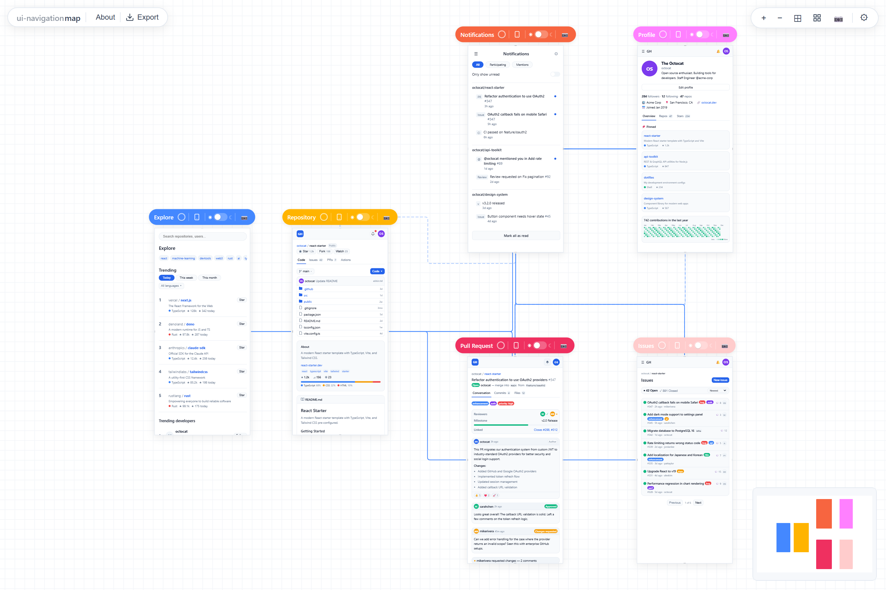

<div align="center">

# UI Navigation Map

<p align="center">
  <strong>An open-source infinite canvas for React developers to visualize navigation flows, test interactive screens, and ship real code.</strong>
</p>

<p align="center">
  <a href="https://github.com/thichankem/UI-Navigation-Map/blob/main/LICENSE"></a>
  
  
  
</p>

<br />

<p align="center">
  
</p>

<p align="center">
  <a href="#quick-start">Quick Start</a> &bull;
  <a href="#key-features">Key Features</a> &bull;
  <a href="#how-it-works">How It Works</a> &bull;
  <a href="#ai-agent-support">AI Agents</a> &bull;
  <a href="#cli-commands">CLI</a> &bull;
  <a href="#license">License</a>
</p>

</div>

---

## Why UI Navigation Map?

AI tools generate working React screens in seconds — but inspecting multi-step navigation, modal transitions, and interactive edge cases across disjointed files is painful. Figma gives spatial clarity but outputs static assets rather than shipping code.

**UI Navigation Map bridges the gap:** Every screen on the canvas is a **live, rendered React component**. What you see is what you ship.

---

## Quick Start

Scaffold wireframes and start the canvas in two commands:

```bash
# 1. Initialize wireframes workspace
npx ui-navigation-map init

# 2. Launch the visual canvas
npx ui-navigation-map dev
```

Project directory structure created:

```text
wireframes/
├── screens/              # Real React screen components (.tsx)
│   ├── Launcher.tsx
│   ├── Dashboard.tsx
│   └── Settings.tsx
├── flows.ts              # Screen coordinates and navigation edges
├── unm.theme.ts          # Central design tokens (CSS custom properties)
├── styles.css            # Tailwind v4 theme bindings
└── AGENTS.md             # Canonical conventions for AI coding agents
```

---

## Key Features

- **Infinite Canvas**: Fluid zoom, pan, and mini-map powered by React Flow v12.
- **Live Component Thumbnails**: Real React components rendered and scaled in real time.
- **Interactive Fullscreen Viewer**: Click any screen to interact with live `useState`, modals, and form inputs.
- **Zero-Config Flow Edges**: Link screens with `data-unm-navigate="targetScreen"` triggers — edges connect automatically.
- **One-Click Auto Arrange**: Intelligent topological DAG layout organizes complex multi-column flows cleanly.
- **Multi-Device Viewports**: Instant toggle between Desktop (1440×900), Tablet (768×1024), and Mobile (390×844).
- **Per-Screen Dark Mode**: Inspect both light and dark variations side-by-side on the same canvas.
- **Full Exports**: Export retina-resolution PNG snapshots or a single-file, self-contained `ui-navigation-map.html` presentation.

---

## How It Works

### 1. Write Screens as Standard React Components

Screens are default-exported React components. Use `data-unm-navigate="target"` to mark buttons or links that trigger transitions:

```tsx
// wireframes/screens/Login.tsx
export default function Login() {
  return (
    <div className="p-8 flex flex-col items-center justify-center min-h-screen bg-surface text-text">
      <h1 className="text-2xl font-bold mb-4">Welcome Back</h1>
      <button
        data-unm-navigate="dashboard"
        className="px-4 py-2 bg-primary text-white rounded-md"
      >
        Sign In
      </button>
    </div>
  )
}
```

### 2. Define Flows & Persistence

Screen positions persist automatically to `flows.ts` whenever nodes are dragged or auto-arranged:

```ts
// wireframes/flows.ts
import type { NavigationMapConfig } from "ui-navigation-map"

const config: NavigationMapConfig = {
  name: "My Studio",
  screens: {
    login: {
      title: "Login Screen",
      file: "./screens/Login.tsx",
      position: { x: 0, y: 0 },
      viewport: "desktop",
    },
    dashboard: {
      title: "Main Dashboard",
      file: "./screens/Dashboard.tsx",
      position: { x: 600, y: 0 },
    },
  },
  edges: [
    { from: "login", to: "dashboard", label: "Sign in" },
  ],
}

export default config
```

---

## AI Agent Support

`init` automatically scaffolds conventions for modern AI coding agents:

| Agent / Environment | Convention Config |
|---|---|
| **Claude Code** | `CLAUDE.md` |
| **Codex** | `AGENTS.md` |
| **Antigravity** | `AGENTS.md` |

---

## CLI Commands

```bash
# Initialize wireframes scaffolding
ui-navigation-map init [--dir ./wireframes] [--no-tailwind] [--name "My App"]

# Run dev canvas server with HMR
ui-navigation-map dev [--dir ./wireframes] [--port 4800]

# Export standalone self-contained offline HTML
ui-navigation-map export [--dir ./wireframes] [--output ./ui-navigation-map.html]
```

---

## Development & Testing

```bash
# Install dependencies
pnpm install

# Run Vitest test suite
pnpm test

# Build dual ESM/CJS packages
pnpm build
```

---

## License

Distributed under the [MIT License](LICENSE). Released September 2026.
